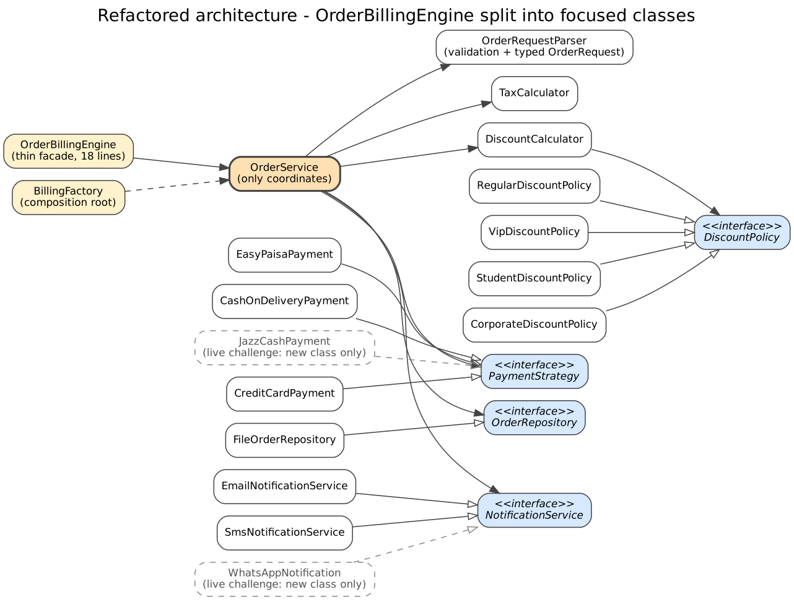

# Task 3 - Clean Refactored Architecture

All classes live in **one package**, `com.uet.billing` (`src/main/java/com/uet/billing`), so NetBeans shows a single package.

(`class_diagram.dot` is the Graphviz source: `dot -Tpng class_diagram.dot -o class_diagram.png`)

## Where each responsibility went

| Legacy responsibility (original lines) | New class(es) | Role |
|---|---|---|
| Input validation (23-55) | `OrderRequestParser`, `InvalidOrderException`, typed `OrderRequest` / `OrderItem` | validation + data classes |
| Discount rules (57-79) | `DiscountCalculator` + `Regular/Vip/Student/CorporateDiscountPolicy` | discount rules |
| Tax rules (83-95) | `TaxCalculator` | tax rules |
| Payment if/else (97-128) | `PaymentStrategy` + `CreditCardPayment`, `EasyPaisaPayment`, `CashOnDeliveryPayment` | payment strategies |
| File saving (130-136) | `OrderRepository` + `FileOrderRepository` | storage |
| Notification if/else (138-147) | `NotificationService` + `EmailNotificationService`, `SmsNotificationService` | notification channels |
| Coordination of all of the above | `OrderService` | coordinator |
| Choosing concrete classes | `BillingFactory` (composition root) | wiring |
| Old public API | `OrderBillingEngine` (18-line facade, so the safety tests run unchanged) | facade (old API) |

## Before and after

| Metric | Before | After |
|---|---|---|
| Classes in `src/main` (without `Demo`) | 1 | 29 |
| `OrderBillingEngine.java` code lines (no blanks/comments) | 125 (160 physical lines) | 18 |
| Longest method | `processOrder`, 130 lines | about 25 lines (`OrderRequestParser.parse`); `OrderService.processOrder` is 18 |
| Nested if/else ladders | 4 (discount, tax, payment, notification) | 0 |
| Magic numbers in business code | about 20 | 0 (named constants) |
| Safety tests passing | 71 / 71 (on legacy code) | 71 / 71 (assertions untouched) |
| Total tests (incl. 3 Open/Closed demo tests) | 71 | 74 / 74 |
| Total production code lines (no `Demo`) | 125 | 641 |

> **Honest note for the viva:** total code grows because one class became 29 small ones
> (interfaces, getters, a builder). What shrinks is the size of the biggest class/method and the
> cost of change: adding JazzCash or WhatsApp is now one new file.

## The 3-minute live challenge

`src/test/java/com/uet/billing/OpenClosedExtensibilityTest.java` already demonstrates it.
To add **JazzCash** in the real code:

1. Create `payment/JazzCashPayment.java` implementing `PaymentStrategy` (copy `EasyPaisaPayment`, change `methodName()` to `"JAZZCASH"`).
2. Add `new JazzCashPayment()` to `BillingFactory.defaultPaymentStrategies()` (wiring only).

To add **WhatsApp**: new class implementing `NotificationService` + one line in
`BillingFactory.defaultNotificationServices()`. `OrderService`, the parser, the calculators and the
other strategies are not touched.

## Known limitation kept on purpose

Money is still `double` so the output is bit-for-bit identical to the legacy code. A production
system should use `BigDecimal`.
